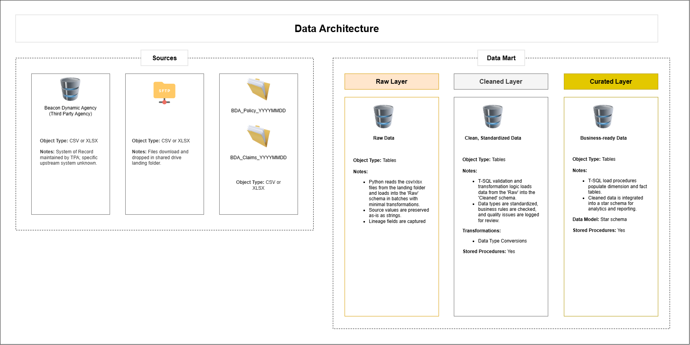
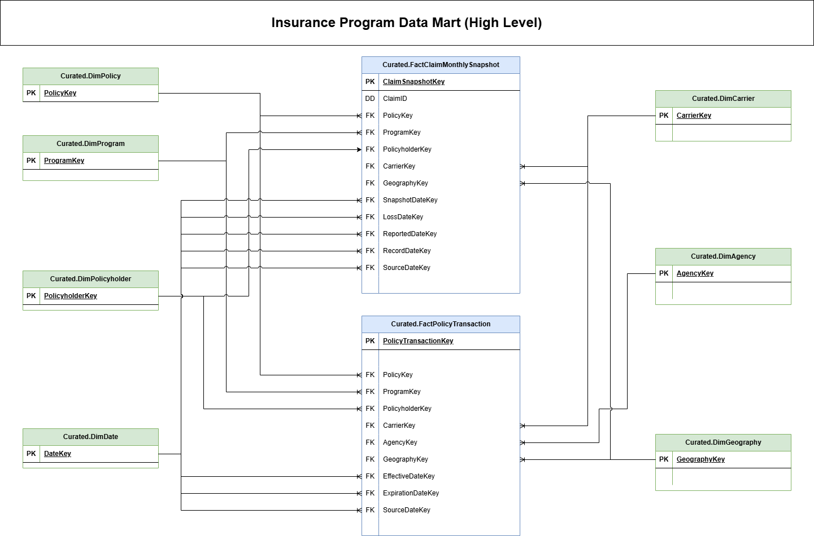
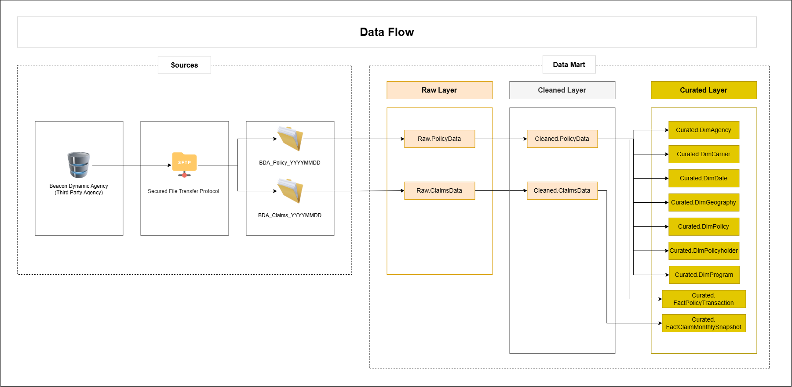

# Insurance Program Data Mart Project

This project simulates the design and implementation of a team-owned data mart for a fictional specialty insurance program. The solution models how policy and claims bordereaux received from a third-party administrator (TPA) can be ingested, validated, transformed, and organized into a dimensional model for insurance reporting and analysis.

The project uses a layered **Raw → Cleaned → Curated** architecture and combines Python-based file ingestion with SQL Server transformation, validation, and dimensional modeling.

## Business Goal

The objective is to create a reliable analytical data mart that supports insurance program administration, financial oversight, and claims reporting for a specialized internal team while also enabling reporting delivered to downstream business functions.

The model is designed to support analysis such as:

- Policy premium and transaction activity
- Carrier, agency, and program-level reporting
- Policyholder and geographic analysis
- Monthly claim balances and claim development
- Indemnity and ALAE reserve and paid activity
- Salvage, subrogation, and deductible recoveries
- Month-over-month claim movement
- Historical as-reported claim snapshots

The project emphasizes data quality, traceability, and dimensional modeling practices that support team-level analytical work while providing trusted reporting outputs to other business areas.

## Project Scenario

The fictional specialty insurance program is administered by **Harborstone**, with source policy and claims bordereaux supplied by **Beacon Dynamic Agency (BDA)**.

Source files simulate a production-style insurance reporting process:

- Policy data is supplied in Excel files.
- Claims data is supplied in CSV files.
- An initial inception-to-date file is followed by recurring monthly files.
- Source data includes lineage information such as source file name, load datetime, batch ID, and TPA name.
- Synthetic data anomalies are included to exercise validation and reconciliation logic.

## Tools Used

- Python
- pandas
- SQLAlchemy
- SQL Server 2022
- T-SQL
- SQL Server Management Studio (SSMS)
- Excel
- Git / GitHub

## Data Architecture

The data pipeline follows a layered architecture:

- **Raw Layer**: Preserves source data with minimal transformation. Source values are retained as strings so data-quality issues remain visible, while lineage and batch metadata are added during ingestion.
- **Cleaned Layer**: Converts source values into appropriate SQL Server data types, standardizes fields, validates relationships and business rules, and records validation issues in a centralized control table.
- **Curated Layer**: Organizes validated data into conformed dimensions and fact tables for analytical reporting.

## Dataset

The project uses synthetic policy and claims bordereaux designed to resemble data received from an external insurance administrator.

Policy data includes information such as:

- Policy and policy transaction identifiers
- Policyholder information
- Program, carrier, and agency information
- Effective, expiration, and retroactive dates
- Coverage limits and retention information
- Premium allocation percentages and amounts
- Taxes and fees
- Treaty year and renewal sequence

Claims data includes information such as:

- Claim and policy identifiers
- Loss, reported, record, and reporting dates
- Claim status
- Indemnity reserve and paid balances
- ALAE reserve and paid balances
- Salvage, subrogation, and deductible recoveries

The claims source may contain multiple valuations for the same claim within a reporting month. The Curated layer selects the latest valuation for each claim and reporting month.

## ETL / ELT Workflow

### 1. Source Ingestion

Python is used to ingest policy and claims files into SQL Server.

The ingestion process:

- Detects supported file types and delimiters
- Reads source values as strings
- Validates expected column structures
- Adds lineage metadata
- Creates and updates batch-control records
- Loads source data into the Raw schema

### 2. Raw Layer

The Raw layer preserves the source data in its original form as closely as possible.

Key design principles include:

- Source values remain unmodified
- Data-quality issues are preserved for investigation
- Each row receives a unique Raw row identifier
- Batch and source-file lineage is retained
- Business transformations are deferred to SQL Server

### 3. Cleaned Layer

Stored procedures load Raw data into strongly typed Cleaned tables.

The Cleaned layer performs:

- Data type conversion
- Date standardization
- Required-field validation
- Numeric and percentage validation
- Policy and claim relationship validation
- Date chronology validation
- Premium allocation reconciliation
- Duplicate detection
- Business-rule validation

Validation issues are written to `Ctl.LoadValidationError` rather than immediately stopping at the first expected data-quality issue. Blocking errors prevent downstream loads, while the validation table preserves detailed information about each issue.

### 4. Curated Layer

The Curated layer implements a dimensional model based on Kimball-style design principles.

Conformed dimensions include:

- `DimDate`
- `DimProgram`
- `DimPolicy`
- `DimPolicyholder`
- `DimCarrier`
- `DimAgency`
- `DimGeography`

The model contains two primary fact tables:

#### FactPolicyTransaction

**Grain:** One row per individual policy transaction for one policy and one program.

The fact table contains premium, allocation, tax, and fee measures and connects to the applicable policy, program, policyholder, carrier, agency, geography, and date dimensions.

#### FactClaimMonthlySnapshot

**Grain:** One row per claim per reporting month, representing the latest claim valuation for that month.

The fact table stores:

- Monthly claim balances
- Indemnity and ALAE reserves
- Indemnity and ALAE paid amounts
- Recovery balances
- Month-over-month movement measures
- Claim status and denial reason
- Multiple role-playing date keys

`ClaimID` is retained directly in the fact table as a degenerate dimension.

The model preserves **as-reported monthly claim snapshots**. Previously loaded snapshots are not overwritten; later corrections are reflected through subsequent reporting activity.

## Dimensional Model

The Curated layer is organized as a dimensional data mart with two primary business processes:

- **Policy Transactions**
- **Claim Monthly Snapshots**

These fact tables share conformed dimensions such as `DimPolicy`, `DimProgram`, `DimPolicyholder`, `DimCarrier`, `DimGeography`, and `DimDate`. `DimAgency` is specific to the policy transaction process.

The high-level dimensional model illustrates how the two fact tables share common dimensions while supporting different grains and analytical use cases.

## Data Quality and Controls

The project includes controls intended to make the load process repeatable and auditable.

Examples include:

- Batch-level load logging
- Source-file lineage
- Raw-to-Cleaned validation
- Cleaned-to-Curated dimension lookup validation
- Policy and claim relationship validation
- Premium allocation reconciliation
- Duplicate detection
- Transaction handling with `try/catch`, commit, rollback, and `xact_abort`
- Validation error logging through `Ctl.LoadValidationError`

## Repository Structure

- /datasets/     &rarr; CSV and XLSX files
- /docs/         &rarr; ERD diagrams
- /scripts/      &rarr; SQL scripts initializing the data mart and Python script for ETL
- README.md      &rarr; Project documentation
